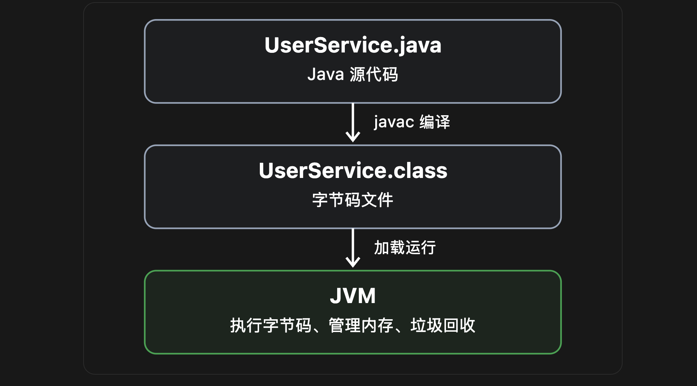
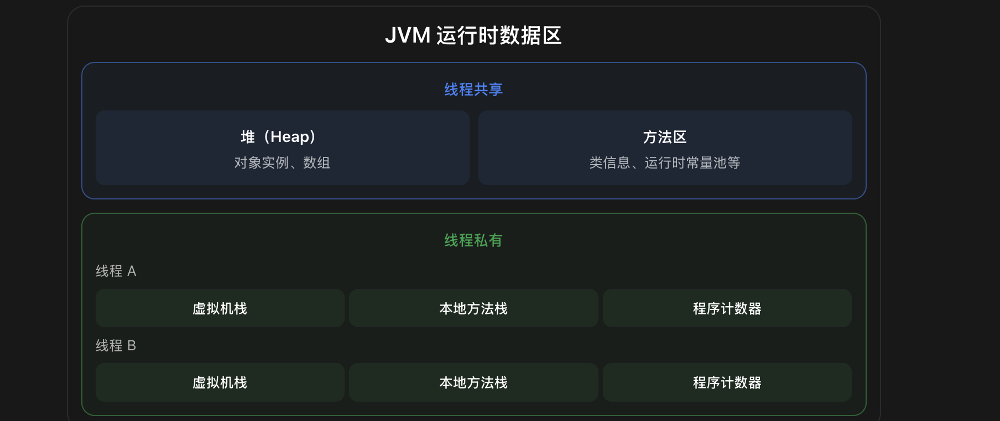
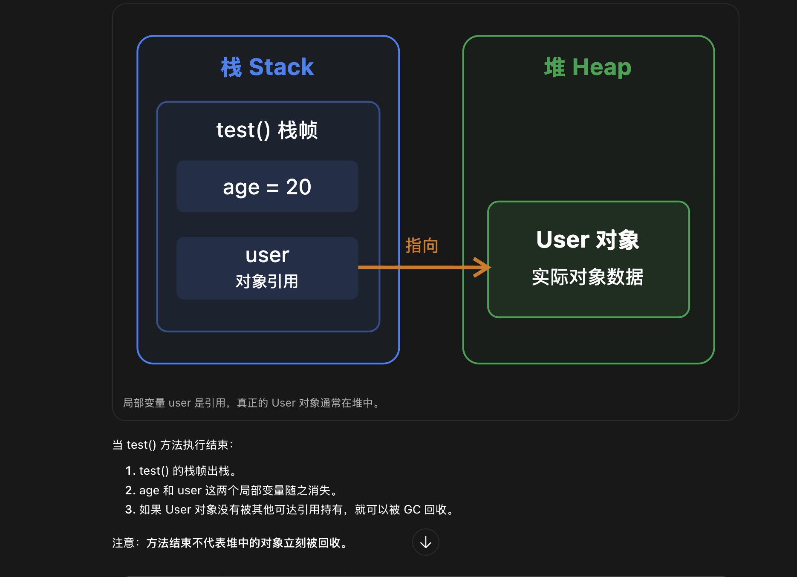
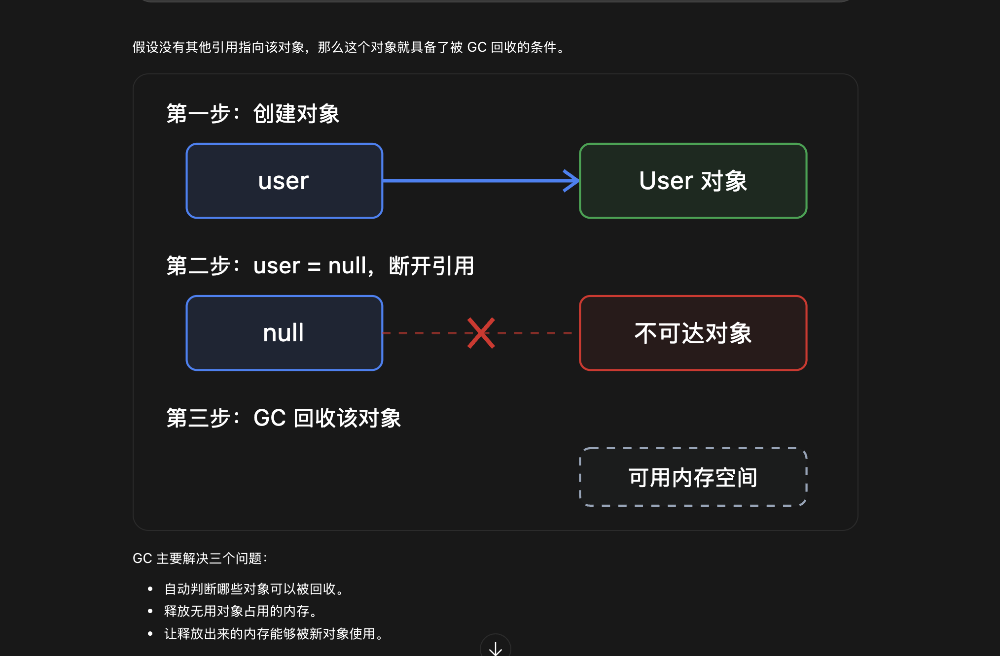
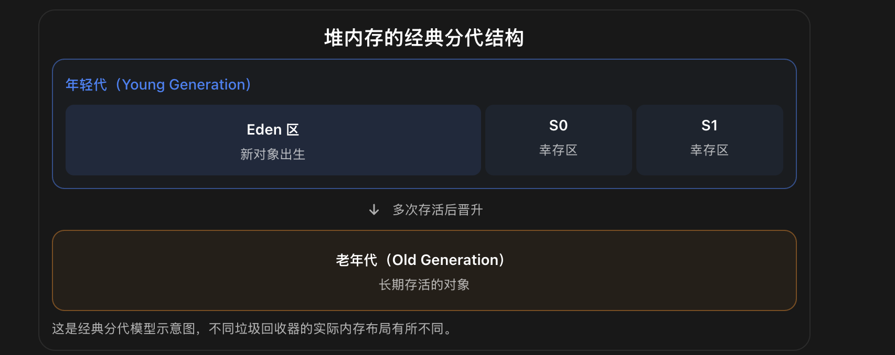
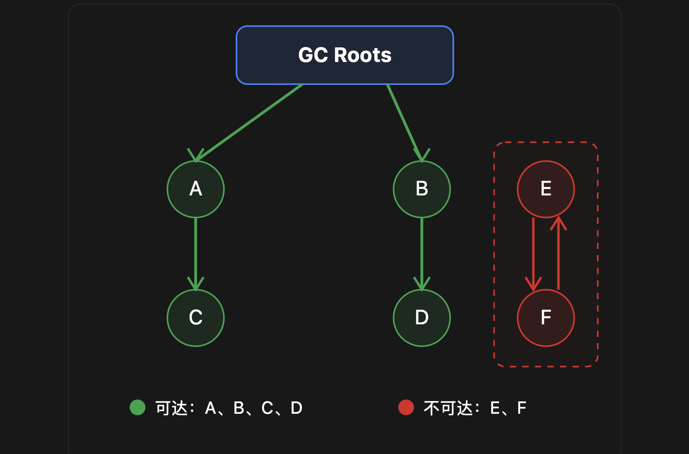

# JVM（Java Virtual Machine）
就是 Java 虚拟机，负责运行 Java 字节码，并管理程序运行时的内存。


## JVM内存结构

堆:对象实例,数组

虚拟机栈:方法调用、局部变量等

方法区:类信息、运行时常量池等

本地方法栈:Native 方法执行相关数据

程序计数器:当前线程字节码执行位置

前三个较为重要

## 堆
主要用来存放创建出来的对象和数组，是 GC 的主要工作区域。
```java
User user = new User();
int[] arr = new int[10];
```
这里的 User 对象和数组对象通常都分配在堆中。

堆是所有线程共享的，因此不同线程可以访问同一个对象。
## 栈
负责管理方法的调用和执行，存放局部变量、对象引用等数据。
```java
public void test() {
    int age = 20;
    User user = new User();
}
```
每调用一个 Java 方法，就会创建一个栈帧；方法执行结束，栈帧就会出栈

## 方法区
主要存储类本身的结构信息，而不是具体创建出来的对象。
```java
public class User {
    private String name;
    private int age;

    public void login() {
        // 登录逻辑
    }
}
```
JVM 加载 User 类后，需要记录它有哪些字段、方法、父类以及相关的运行时常量池等信息。

可以把它理解成：
- 方法区：建筑设计图纸。
- 堆：根据图纸建造出来的房子。
- 栈：施工人员当前手里的工作记录。

## GC是什么,解决什么问题
GC（Garbage Collection）就是垃圾回收机制，负责自动识别并回收不再使用的对象所占用的内存。

在java中
```java
User user = new User();
user = null;
```


## 年轻代和老年代
VM 的分代垃圾回收基于一个重要规律：绝大多数对象的生命周期都很短，只有少部分对象会长期存活。

因此，常见的分代垃圾回收器会将堆划分为年轻代和老年代。



### 年轻代
```java
public ArticleVO getArticle(Long articleId) {
    ArticleDO article = articleMapper.selectById(articleId);

    ArticleVO vo = new ArticleVO();

    return vo;
}
```
其中产生的 ArticleDO、ArticleVO 等对象，通常都是生命周期较短的对象。

请求处理完成后，如果不再被引用，就可以被垃圾回收。

年轻代通常是垃圾回收比较频繁的区域。

### 老年代
```java
@Service
public class ArticleServiceImpl {
    // 业务逻辑
}
```
Spring 容器通常会长期持有这个 Service 对象，因此它可能在经历多次 GC 后晋升到老年代。

## GC Roots 是什么？
前面说过，GC 会回收不再使用的对象。

但是 JVM 怎么知道哪个对象不再使用呢？

这就需要 GC Roots。

GC Roots 是垃圾回收时用于搜索存活对象的一组根引用。

## 可达性分析
可达性分析就是从 GC Roots 出发，沿着对象之间的引用关系向下搜索。
- 能够被搜索到的对象：可达对象，不能直接回收。
- 无法被搜索到的对象：不可达对象，具备被回收的条件。

