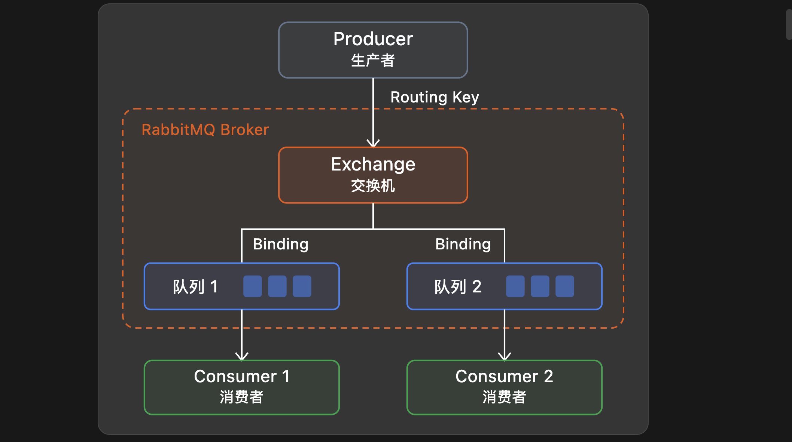
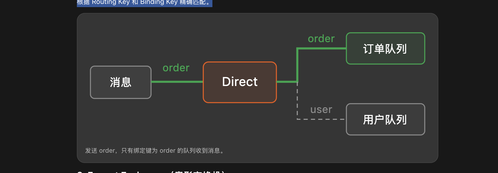
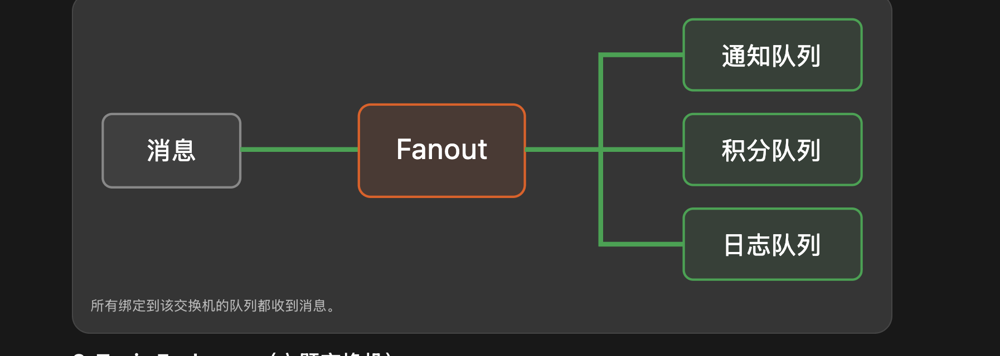
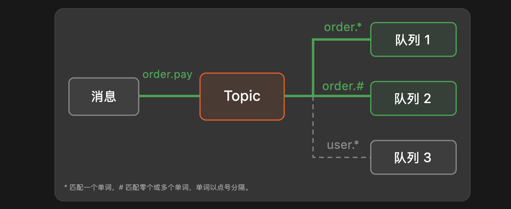

# RabbitMQ
用于统一管理消息,将其分配给不同的消费者处理的方法
RabbitMQ 是一种消息中间件，用于在不同服务或业务模块之间传递消息，实现异步处理、系统解耦和流量削峰。
## RabbitMQ核心组成
- Producer:生产者,负责发送消息
- Routing Key:路由键,发送消息时携带的路由标识
- Exchange:交换机,决定消息应该发到哪个队列
- Queue:消息队列,存储等待消费的消息
- Consumer:消费者,负责接受并处理消息

## 四种交换机类型
1. Direct Exchange（直连交换机）
根据 Routing Key 和 Binding Key 精确匹配。

2. Fanout Exchange（扇形交换机）
广播消息，不关心 Routing Key。

3. Topic Exchange（主题交换机）
根据通配符进行模糊匹配。

4. Headers Exchange（头部交换机）
根据消息 Headers 中的键值对进行匹配，而不是根据 Routing Key。实际开发中相对少见，了解即可。
速记：Direct 精确匹配，Fanout 全部广播，Topic 通配符匹配，Headers 属性匹配。
